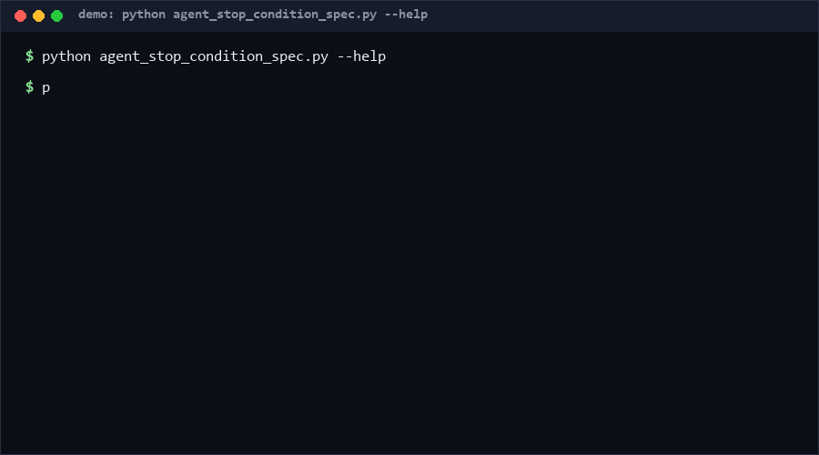

# agent-stop-condition-spec

A formal, declarative spec for agent stop conditions — termination predicates, turn budgets, token ceilings, no-progress windows — plus a structural validator and an unreachable-termination detector that runs *before* the agent does. This is a spec and static checker, not a runtime stopper. Pure standard library, single file, offline. *Adjacent to framework built-ins, not equivalent to them.*

<p align="center"></p>

## Problem

Every agent framework ships stop logic — AutoGen has `TerminationCondition`, LangGraph has recursion limits, Claude-family CLIs have stop hooks. But the stop policy is scattered across framework calls, hardcoded constants, and tribal knowledge, so "why did the agent stop (or not)?" is answered by reading code. There is no framework-independent artifact that declares the stop conditions, can be reviewed like code, and can be statically checked for self-contradiction — e.g. a predicate that requires 10 turns under a 5-turn budget.

## How it works

A **spec** is a JSON document: an ordered list of `conditions` plus an `ordering` (`any` = stop when the first fires, `all` = stop only when all fire). Condition types:

- `max_turns` / `token_budget` / `timeout_ms` — numeric, integer `value > 0`;
- `predicate` — an opaque boolean `expression` plus optional `min_turns`;
- `no_progress` — a `window` (≥2) of turns without progress;
- `handoff` — stop when control is handed off (no parameters).

`validate` enforces structure (R1–R7: non-empty, unique ids, known types, value domains). `check` runs the reachability logic (exit 1 on error):

| Rule | Sev | Meaning |
|---|---|---|
| U1 | error | no conditions at all — termination unreachable |
| U2 | error | `ordering=all`: predicate `min_turns` exceeds `max_turns` — unsatisfiable |
| U3 | error | `ordering=all`: two same-type numeric conditions with different values |
| U4 | warning | `ordering=any`: predicate can never fire before the turn budget stops the run |
| U5 | warning | duplicate numeric condition with a different value (first wins under `any`) |
| U6 | warning | `no_progress` window exceeds `max_turns` under `all` |

## How this differs from framework built-ins

AutoGen's `TerminationCondition`, LangGraph's recursion limit, CrewAI's `max_iter`, and stop-hook mechanisms are **runtime implementations**: they evaluate conditions while the agent runs, inside their own framework, with their own APIs — and none of them accepts an external, reviewable declaration of the full stop policy, nor can they tell you *before a run* that your policy contradicts itself. This repo works at the **spec layer**: the same declaration can be diffed in review, enforced in CI, and statically checked for unreachable or unsatisfiable termination (U1–U6) with no agent process, no model call, and no framework dependency. It deliberately does not implement stopping — consumers translate the spec into their framework's conditions, and the test suite in this repo is the conformance surface for that translation.

## Quickstart

```console
$ python agent_stop_condition_spec.py validate stop-spec.json     # <0.1 s
OK: no findings
$ python agent_stop_condition_spec.py check stop-spec.json
error   U2 [done] predicate min_turns=10 can never fire before max_turns=5 under ordering=all
```

Checking a spec is sub-millisecond; 5,000 synthetic specs validate in 0.03 s [Measured] (see Performance).

## Why not X

- **AutoGen TerminationCondition** (and LangGraph/CrewAI equivalents) — runtime evaluation inside one framework; no external declaration artifact, no pre-run contradiction checks. See the section above.
- **JSON Schema** — can require that fields exist, but cannot compare conditions against each other ("this predicate needs more turns than that budget allows").
- **Policy engines (OPA/Rego)** — general-purpose and heavyweight; they have no notion of termination semantics, so every check would be hand-written Rego with no shared vocabulary.
- **Hardcoded constants + code review** — the status quo: unreachable-termination bugs are found by watching an agent burn tokens, not by a linter.

## Performance

All numbers [Measured] locally (Python 3.13, Windows 10, single core):

| Workload | Result | Command |
|---|---|---|
| 5,000 synthetic specs, validate+check | 0.02 s (~200k specs/s) | `python agent_stop_condition_spec.py bench --specs 5000` |
| Single spec check | <1 ms | `python agent_stop_condition_spec.py check stop-spec.json` |

`bench` generates deterministic specs and times only the two rule engines.

## Minimal Fallback

Without this tool: write the stop policy as a Markdown table in the repo (`condition, type, value, ordering`) and require review approval for edits. You lose all mechanical checks — the min_turns > max_turns class of bug is exactly what eyeballing misses — but the table alone still beats policy scattered across framework calls.

## Design Trade-offs

- **Opaque predicate expressions.** We check presence and `min_turns`, never parse the expression: parsing arbitrary host-language booleans is out of scope and would create a false sense of semantic safety.
- **`ordering=all` is stricter on purpose.** Most U-rule errors only exist under `all`; under `any` they degrade to warnings, because a working stop condition elsewhere masks them at runtime.
- **Warnings for duplicates under `any`.** Silently keeping the first value is legal but surprising; surfacing it costs nothing and catches copy-paste edits.
- **No runtime library.** Shipping a runtime would tie the spec to one executor's semantics; the spec stays neutral, translations are testable.

## Limits & Second-order Effects

- A lint-clean spec can still stop badly at runtime: conditions are declarative, and real "no progress" detection is the executor's job.
- Teams may treat a passing spec as proof of safe stopping — it only proves internal consistency, not coverage of failure modes (e.g. no token ceiling declared at all is not flagged unless U1 fires).
- Once specs exist, platform drift begins: frameworks evolve new condition types and the spec vocabulary lags behind.
- Specs can be copied between agents without adjusting values (`max_turns=3` copied to a 40-step workflow silently degrades behavior).

## FAQ

**When NOT to use this?** If your agent runs inside one framework and its stop conditions are two lines of config, write them down in the README and move on. Also skip it if you need runtime enforcement *right now* — use the framework's conditions, and adopt the spec layer when the policy spans frameworks or teams.

**Does it stop my agent?** No. It never executes anything — that is the whole point of keeping the spec layer separate from runtime implementations.

**Why is U4 only a warning?** Under `any`, another condition still stops the run; the predicate being dead is a policy smell, not an unbounded-run risk.

**Can the expression reference host state?** The spec does not care — the expression is a string your executor evaluates. This tool checks the policy's structure, not your program.

## [Core Assumptions]

1. Stop policies deserve the same review discipline as code: a versioned, diffable artifact reviewed in PRs.
2. The six condition types cover the common agent-orchestration vocabulary; exotic types are expressible as `predicate`.
3. Static contradiction detection (U2/U3) catches a real bug class that runtime testing routinely misses, because the failure mode is "never fires" not "crashes".
4. Teams translating the spec into framework calls will keep the translation honest — the spec layer cannot observe the runtime.

Confidence: High (≥80%) for the structural rules and U1–U3/U5–U6 (pure static mechanics); Medium (60-79%) for the claim that spec-level linting reduces real-world runaway-agent incidents, and for the six-type vocabulary's coverage. As of 2026-10-13.

---

Part of the [zhengming-toolbox](https://github.com/chenhz01/zhengming-toolbox) — 105 purpose-built AI-engineering tools across neglected niches.

Related tools: [agent-loop-detector](https://github.com/chenhz01/agent-loop-detector) · [agent-permission-audit](https://github.com/chenhz01/agent-permission-audit) · [agent-trace-compression](https://github.com/chenhz01/agent-trace-compression)
